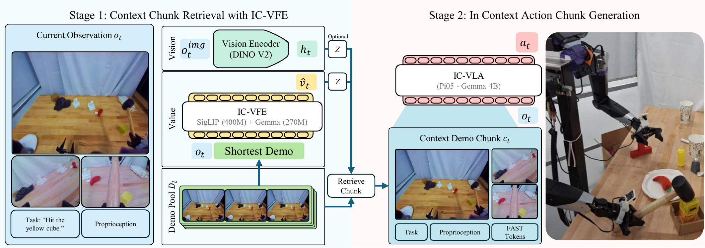

<div align="center">

# VICTR: Value-Informed In-Context Learning<br>for Vision-Language-Action Models

[Luca Macesanu](https://lucamacesanu.wixsite.com/lucamacesanu)<sup>1,\*</sup>,
[Tianluo Zhang](https://lewiszzz-zhang.github.io/)<sup>1,\*</sup>,
[Aditya Patil](https://adityx23.github.io/adityapatil/)<sup>1</sup>,
[Archit Sharma](https://hannibalofbarca.github.io/)<sup>1</sup>,
[Kevin Angers](https://kevinangers.github.io/)<sup>1</sup>,
<br>
[Christopher M. Clark](https://engineering.nyu.edu/faculty/christopher-clark)<sup>1,‡</sup>,
[Chen Feng](https://engineering.nyu.edu/faculty/chen-feng)<sup>1,‡</sup>,
and [Juexiao Zhang](https://juexzz.github.io/)<sup>1,‡</sup>

<sup>1</sup>New York University &nbsp;·&nbsp; <sup>\*</sup>Co-first authors &nbsp;·&nbsp; <sup>‡</sup>Co-advising

<p>
  <a href="https://arxiv.org/abs/2611.08698"></a>
  <a href="https://arxiv.org/pdf/2611.08698"></a>
  <a href="https://ai4ce.github.io/VICTR/"></a>
  <a href="https://huggingface.co/collections/ai4ce/victr-value-informed-in-context-learning-for-vlas-6af362deff10640a6be06b31"></a>
  <a href="https://huggingface.co/datasets/lair-nyu/victr-icl-dataset"></a>
  <a href="https://huggingface.co/lair-nyu/victr-assets"></a>
</p>

<p>
  <a href="#overview">Overview</a> ·
  <a href="#code-release">Code release</a> ·
  <a href="#setup">Setup</a> ·
  <a href="#pipeline">Pipeline</a> ·
  <a href="#citation">Citation</a>
</p>



<p align="left"><sub><b>VICTR method overview.</b> The IC-VFE conditions on a reference
demonstration (the shortest in the pool) to produce a progress estimate for the current
observation. This is optionally fused with visual similarity, driving retrieval of a context
chunk from the demonstration pool. The IC-VLA conditions on the retrieved chunk to predict
the next action chunk, closing the loop without any parameter updates.</sub></p>

</div>

---

## Overview

**VICTR** enables in-context learning (ICL) in vision-language-action (VLA) models through
*progress-informed* context retrieval. An **In-Context Value Function Estimator (IC-VFE)**
conditions on a reference demonstration video, a language instruction and the current
observation to estimate task-relative progress. VICTR uses that estimate to retrieve
demonstration chunks from the matching stage of execution, and gives them as context to a
π<sub>0.5</sub> policy post-trained for in-context action generation. No weights are
updated at deployment.

On unseen out-of-domain real-world manipulation tasks, VICTR raises the success rate of a
fine-tuned π<sub>0.5</sub> baseline from **6.2% → 23.8%** and nearly doubles task progress,
from **28.9% → 55.5%**.

<details>
<summary><b>Abstract</b></summary>
<br>

Recent advances in robot foundation models have highlighted the potential of in-context
learning (ICL) for adapting robot behavior from demonstrations without further fine-tuning.
Previous work has used retrieval-based post-training to equip pretrained
vision-language-action (VLA) models with the capability for ICL by teaching them to
condition action predictions on retrieved visually-relevant demonstration chunks. However,
the effectiveness of retrieval hinges on selecting context relevant to the current execution
stage, which visual similarity alone may not capture. We introduce VICTR, a framework
enabling in-context learning in VLAs via progress-informed context retrieval built around an
In-Context Value Function Estimator (IC-VFE). IC-VFE conditions on a reference demonstration
video, a language instruction and the current observation to estimate task-relative
*progress*. By conditioning progress estimation on a reference demonstration, IC-VFE can
align the current state with a demonstrated execution even for tasks unseen during training.
VICTR uses the estimated progress to select demonstration chunks at corresponding stages of
execution and supplies them to a π<sub>0.5</sub> policy post-trained for in-context action
generation. On unseen out-of-domain real-world manipulation tasks, VICTR raises the success
rate from 6.2% for a fine-tuned π<sub>0.5</sub> baseline to 23.8% and nearly doubles the
task progress rate, from 28.9% to 55.5%.

</details>

## Code release

This branch (`release`) contains the **VICTR policy training code** used for the paper.
Models and training live in a fork of [openpi](https://github.com/Physical-Intelligence/openpi)
(`third_party/openpi`, JAX). This top-level repo holds the scripts that drive it, plus the
data-preparation utilities used to build the retrieval pools. The other components are on
their own branches:

| Branch | Contents |
| --- | --- |
| **[`release`](https://github.com/ai4ce/VICTR/tree/release)** (this branch) | VICTR policy training: retrieval-pool construction and openpi training configs |
| [`IC-VFE`](https://github.com/ai4ce/VICTR/tree/IC-VFE) | In-Context Value Function Estimation: training, evaluation and released checkpoints |
| [`main`](https://github.com/ai4ce/VICTR/tree/main) | Robot inference stack (inference server, live retrieval, operator UI) and the coding-agent baseline experiments |
| [`integrate`](https://github.com/ai4ce/VICTR/tree/integrate) | All three components combined in one tree |
| [`pages`](https://github.com/ai4ce/VICTR/tree/pages) | Source of the [project page](https://ai4ce.github.io/VICTR/) |

| Resource | Link |
| --- | --- |
| All models and datasets | [🤗 VICTR collection](https://huggingface.co/collections/ai4ce/victr-value-informed-in-context-learning-for-vlas-6af362deff10640a6be06b31) |
| ICL demonstration dataset | [🤗 lair-nyu/victr-icl-dataset](https://huggingface.co/datasets/lair-nyu/victr-icl-dataset) |
| Training assets (retrieval pools, FAST tokenizer, stage-1 checkpoint) | [🤗 lair-nyu/victr-assets](https://huggingface.co/lair-nyu/victr-assets) |

## Layout

| Path | Contents |
|---|---|
| `third_party/openpi/src/openpi/models/pi0_victr.py` | π0.5 + retrieved-context conditioning (VICTR) |
| `third_party/openpi/src/openpi/models/pi0_fast_victr.py` | π0-FAST + retrieved context, with RICL-style action interpolation |
| `third_party/openpi/src/openpi/policies/yor_retrieval.py` | retrieval (vision / value / vision+value) and context construction |
| `third_party/openpi/src/openpi/policies/yor_policy.py` | dataset ↔ model transforms (canonical pos + rot6d state/action space) |
| `third_party/openpi/src/openpi/training/config.py` | training configs (see below) |
| `third_party/openpi/scripts/precompute_retrieval_context.py` | offline retrieval for every training frame |
| `shells/` | entry points: `download_data.sh`, `precompute_context.sh`, `train.sh` |
| `scripts/`, `src/viktr/` | retrieval-pool construction (DINOv2 embeddings, chunk dictionaries, FAST tokenizer fit) |

## Setup

Requirements: Linux x86_64, NVIDIA GPU(s) with CUDA 12, [uv](https://docs.astral.sh/uv/).

```bash
git clone --branch release --recurse-submodules https://github.com/ai4ce/VICTR.git victr
cd victr/third_party/openpi
GIT_LFS_SKIP_SMUDGE=1 uv sync
cd ../..
```

All steps below use the openpi environment (`third_party/openpi/.venv`). The scripts
in `shells/` find it automatically. For fast video decoding, install FFmpeg 4–7
(e.g. `apt install ffmpeg` or `conda install ffmpeg`); without it, LeRobot falls back
to the slower PyAV decoder.

## Training configs

| Config | Model | Retrieval | Init from |
|---|---|---|---|
| `yor_icl_pi05_canonical_extended` | π0.5 | – | `pi05_base` (**stage 1**) |
| `yor_icl_pi05_canonical_warmstart_baseline` | π0.5 | – | stage 1, step 40k |
| `yor_icl_victr_vision_canonical_ctx3cam` | VICTR (π0.5) | vision | stage 1, step 40k |
| `yor_icl_victr_value_canonical_ctx3cam` | VICTR (π0.5) | value | stage 1, step 40k |
| `yor_icl_victr_vision_value_canonical_ctx3cam` | VICTR (π0.5) | vision + value | stage 1, step 40k |
| `yor_icl_victr_vision_interp_canonical_ctx3cam` | VICTR (π0.5) + action interpolation (RICL-style) | vision | stage 1, step 40k |
| `yor_icl_pi0_fast_canonical` | π0-FAST | – | `pi0_fast_base` |
| `yor_icl_fast_victr_vision_interp_canonical` | π0-FAST + context + action interpolation (RICL) | vision | `pi0_fast_base` |

All configs train on the same 20-task, 1,186-episode bimanual set
(`third_party/openpi/assets/yor_icl_canonical_extended_episodes.json`) and share one
set of normalization statistics (`.../assets/yor_icl_pi05_canonical_extended/`), both
committed to the repo.

## Pipeline

### 1. Download data and assets

```bash
shells/download_data.sh            # dataset (~16 GB), FAST tokenizer, 3-camera retrieval pool (42 GB)
shells/download_data.sh --fast     # + single-camera pool, 15 GB (only for yor_icl_fast_victr_vision_interp_canonical)
shells/download_data.sh --stage1   # + stage-1 checkpoint (12 GB), to skip step 3
```

By default, data is placed under `third_party/openpi/data/` and
`third_party/openpi/assets/`. To use other locations, set `VICTR_DATA_ROOT`,
`VICTR_FAST_TOKENIZER`, `VICTR_RETRIEVAL_CONTEXT_DIR` and `VICTR_WARMSTART_PARAMS`
(read by both the shell scripts and `config.py`).

### 2. Precompute retrieval context (VICTR configs only)

Retrieval is run offline once per training frame, so the dataloader does an array
lookup instead of a live DINOv2 embedding + nearest-neighbour search.

```bash
shells/precompute_context.sh ctx3cam vision         # yor_icl_victr_vision_canonical_ctx3cam
shells/precompute_context.sh ctx3cam value          # yor_icl_victr_value_canonical_ctx3cam
shells/precompute_context.sh ctx3cam vision_value   # yor_icl_victr_vision_value_canonical_ctx3cam
shells/precompute_context.sh ctx3cam_interp         # yor_icl_victr_vision_interp_canonical_ctx3cam
shells/precompute_context.sh fast_interp            # yor_icl_fast_victr_vision_interp_canonical
```

`NUM_SHARDS` (default 4) sets the number of parallel worker processes. Each worker
holds one task's retrieval pool in RAM, so lower it if you run out of host memory.
The precompute can be restarted: episodes that are already done are skipped.

### 3. Stage 1: π0.5 fine-tune

```bash
shells/train.sh yor_icl_pi05_canonical_extended stage1
```

The VICTR configs and the warm-start baseline initialize from this run's step-40000
checkpoint (`third_party/openpi/checkpoints/yor_icl_pi05_canonical_extended/stage1/40000/params`).
Skip this step if you downloaded it with `--stage1`.

### 4. Train VICTR and baselines

```bash
shells/train.sh yor_icl_victr_vision_value_canonical_ctx3cam main
shells/train.sh yor_icl_pi05_canonical_warmstart_baseline main
# ... any config from the table above
```

Pass `--resume` to continue an interrupted run, or `--overwrite` to restart one.
Any other `scripts/train.py` flag can be appended, e.g. `--batch-size 64` or
`--no-wandb-enabled`.

### Hardware

The paper's runs used 2× H200 (141 GB) per run, with a global batch size of 256 (64 for
`yor_icl_fast_victr_vision_interp_canonical`). openpi shards the batch across every
visible GPU. On smaller GPUs, reduce `--batch-size`. Note that this changes the
optimization relative to the paper (openpi has no gradient accumulation), and the
learning-rate schedules in `config.py` were tuned for the original batch sizes.

## Rebuilding the retrieval pools (optional)

The pools downloaded in step 1 were built with `scripts/build_retrieval_pool.py`
(DINOv2 chunk embeddings + RoboDopamine progress values),
`scripts/fit_canonical_fast_tokenizer.py`, and `scripts/build_pool_canonical_3cam.py`
(adds all three camera views and pre-tokenized 30-step action windows). These scripts
run in the top-level environment (`uv sync` at the repo root).

## Citation

If you find VICTR useful in your research, please cite:

```bibtex
@article{macesanu2026victr,
  title   = {VICTR: Value-Informed In-Context Learning for Vision-Language-Action Models},
  author  = {Macesanu, Luca and Zhang, Tianluo and Patil, Aditya and Sharma, Archit and
             Angers, Kevin and Clark, Christopher M. and Feng, Chen and Zhang, Juexiao},
  journal = {arXiv preprint arXiv:2611.08698},
  year    = {2026},
  url     = {https://arxiv.org/abs/2611.08698}
}
```

## Acknowledgements

Built on [openpi](https://github.com/Physical-Intelligence/openpi) (Apache-2.0) and
[LeRobot](https://github.com/huggingface/lerobot). Action interpolation follows
[RICL](https://arxiv.org/abs/2508.02062).
